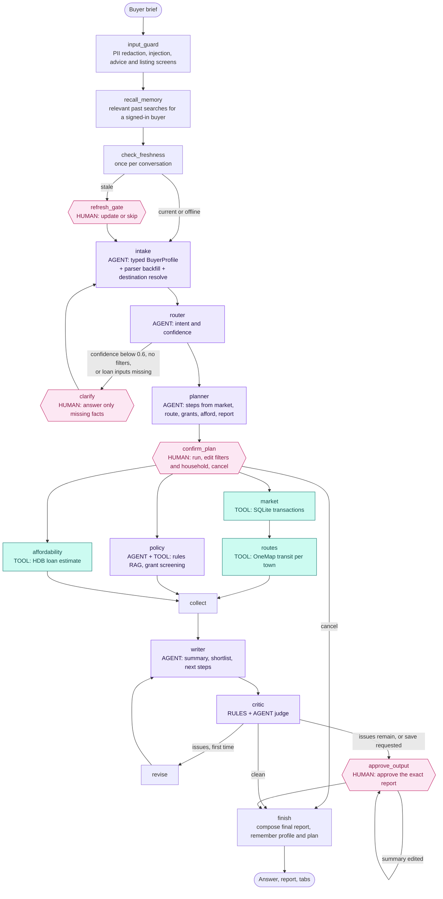

# HDB Resale Research Advisor: agent architecture

The buyer talks to **one assistant**. Behind it, a LangGraph `StateGraph` runs **six model-backed agents**, **deterministic tools** for every figure, **four human-in-the-loop gates**, and layered **guardrails**. The agents interpret, plan, explain and check. They never produce a price, a grant amount, a loan figure or a commute time themselves. Those come only from tools.

> Source of truth: [`hdb_advisor/graph.py`](../hdb_advisor/graph.py). The diagram and tables below mirror its nodes and edges.
> To study the code step by step, follow the [reading guide](READING_GUIDE.md).

---

## 1. The agentic cycle at a glance

| Stage (CA6123) | What happens | Where |
| --- | --- | --- |
| **Perceive** | Redact PII, screen for injection, check data freshness, extract a typed buyer profile, resolve the commute destination | `guards.py`, `freshness.py`, `agents.py` (Intake), `onemap.py` (`resolve_destination`) |
| **Reason** | Classify intent, ask a clarifying question if needed, choose tools from a fixed vocabulary | `agents.py` (Router, Planner), `graph.py` (`route_after_classification`) |
| **Human** | Approve or edit the plan and household facts, answer clarifications, approve the exact final report | `graph.py` interrupts, `streamlit_app.py` forms |
| **Action** | Query transactions, route commutes, retrieve rules and screen grants, estimate the loan (in parallel) | `market.py`, `onemap.py`, `policy.py`, `mcp_tools.py` |
| **Report** | Render cited figures in code; the Writer adds a grounded summary and shortlist; the Critic checks it | `report.py`, `agents.py` (Writer, Critic) |
| **Learn** | Short-term memory (conversation state and history), long-term memory (preferences, consented household facts, past-search summaries), few-shot examples from approved corrections | `memory.py`, `examples/*.jsonl`, `graph.py` (`recall_memory`, `finish`) |

---

## 2. Workflow graph



Key properties:
- **Parallel fan-out.** After the plan is approved, `market`, `policy` and `affordability` run concurrently. `routes` waits for `market` because it needs one example block per town.
- **Bounded loops.** The Critic can send the narrative back to the Writer **once**. An edited summary at approval loops back to the same gate, so nothing is saved unseen.
- **Every turn starts with the guard** and ends at `finish`, which stores the approved profile and plan for follow-ups.

---

## 3. Node reference

| Node | Kind | Responsibility | Output to state |
| --- | --- | --- | --- |
| `input_guard` | Guard | Redact NRIC, phone, card and email; flag direct instructions, investment advice and "is it for sale" questions | `brief`, `guard_events` |
| `recall_memory` | Memory | Recall up to 3 relevant past-search memories for a signed-in buyer; drop any that look like instructions | `memories` |
| `check_freshness` | Tool | Compare the local snapshot with the data.gov.sg metadata (3 s timeout, once per thread) | `freshness` |
| `refresh_gate` | Human | Ask before downloading a newer CSV; validate and swap atomically, or keep the old data | `freshness` |
| `intake` | Agent | Gemini extracts a `BuyerProfile`; the rule parser fills gaps; preferences, carried follow-up facts and form updates are merged; the destination is resolved | `profile`, `refinement`, `destination` |
| `router` | Agent | Classify `research`, `grants`, `affordability`, `explain` or `out_of_scope` with a confidence | `intent`, `confidence` |
| `clarify` | Human | Ask only for missing facts and show what is already known | `brief`, `updates` |
| `planner` | Agent | Choose steps; the intent constrains which steps are allowed; follow-ups keep earlier steps | `plan`, `rationale` |
| `confirm_plan` | Human | Show the filters and household facts; run exactly the on-screen values, or cancel | `profile`, `plan`, `cancelled` |
| `market` | Tool | Parameterised read-only SQL over registered resale transactions; medians and quartiles per town | `market` |
| `routes` | Tool | OneMap public-transport time, weekday 08:00, from one example block per town (cached) | `routes` |
| `policy` | Agent + tool | Retrieve dated rule passages (agentic RAG), assess each grant, verify against the rule engine | `grants`, `evidence` |
| `affordability` | Tool | Illustrative HDB loan from dated thresholds, or a specific reason it needs HDB review | `affordability` |
| `collect` | Join | Merge tool steps, token and call counts, policy guard events | `tool_steps`, counters |
| `writer` | Agent | Summary, up to three towns with reasons, next steps, from compact tool data only | `narrative` |
| `critic` | Rules + agent | Hard grounding rules first, then a model judge; returns specific issues | `critic_issues` |
| `revise` | Loop | Allow one rewrite with the Critic's issues | `revision` |
| `approve_output` | Human | Preview the composed final Markdown; approve, edit and re-preview, or reject; save if requested | `approved_report`, `saved_path` |
| `finish` | Join | Final report; remember `last_profile` and `last_plan`; cancelled turns produce no report | `canonical_report` |

---

## 4. The six agents

All agents use Gemini (`gemini-3.5-flash-lite` by default) through structured output with Pydantic contracts. Each has its own system prompt, receives only the state it needs, and sees tool data wrapped in `<tool_data>` tags marked as data. If a model call fails or the budget is spent, a deterministic fallback completes the step.

| Agent | Decides | Input context | Output contract | Verified by |
| --- | --- | --- | --- | --- |
| **Intake** | Which facts the buyer stated | Redacted brief, few-shot examples | `BuyerProfile` (partial; unknown stays `null`) | Rule parser backfills missed facts; window and living arrangement read deterministically; `anchor_id` set only by the OneMap resolver |
| **Router** | What the buyer is asking for | Brief, plus the previous search for follow-ups | `RouterOutput(intent, confidence)` | Confidence below 0.6 triggers `clarify`; guard events override (blocked, advice, listings) |
| **Planner** | Which tools to run | Intent and profile | `PlanOutput(plan, rationale)` | Allowed steps per intent; finance tasks tracked independently; route needs a resolved destination |
| **Policy** | Which rule passages apply, and each grant's status | Policy question, grant-relevant profile fields, lookup tool (2 calls max) | `PolicyOutput(chunk_ids, assessments[])` | `reconcile_grants`: the rule engine decides; disagreement keeps the conservative result and logs `policy_disagreement` |
| **Report writer** | How to summarise and which towns to put first | Compact ranked town summaries, filters, grant and loan results | `Narrative(summary, shortlist[≤3], next_steps[≤3])` | Critic hard rules |
| **Critic** | Whether the narrative overstates the data | Narrative and the same compact data | `Critique(acceptable, issues[≤3])` | Runs only after the deterministic checks pass; one rewrite, then human approval |

**Critic hard rules** (`guards.check_narrative`, `report.claim_issues`, `report.narrative_issues`):
- Every figure must exist in the tool data, **and** be bound to the right town and measure ("Woodlands median S$600,000" fails if S$600,000 is the budget).
- Shortlisted towns must come from the supplied list.
- No "for sale", "available now", "guaranteed", "you are eligible", buy/sell timing or price predictions.
- No links, markup, personal identifiers or instruction-like text.

---

## 5. Tools

| Tool | Source | Behaviour on failure |
| --- | --- | --- |
| `search_market` | `data/hdb.db` (`resale_tx`), read-only connection, parameterised SQL | Error message in the result; never raises into the graph |
| `resolve_destination` | Destination cache, then OneMap search (top match), cached with the address | `not_found` or `offline_unknown`; no commute is estimated and the report says so |
| `route_to_anchor` | Route cache, then OneMap transit routing; straight-line proxy labelled "not a travel time" | `no_route` / `geocode_failed`; an ambiguous geocode is never guessed |
| `retrieve_rules` | Chroma index of 12 dated sections from 6 HDB and CPF pages (local embeddings) | Empty result leads to "need more information" |
| `evaluate_grants` | `config/rules_2026-11-23.yaml` (each value cites its source URL) | Missing facts listed by name; unclear cases referred to HDB |
| `estimate_affordability` | Same rules file: 75% loan-to-value, 30% of income, 3.0% assessment floor, 2.60% rate, term = shortest of 25 years, 65 − average age, lease − 20 | `need_more_info` with field names, or `manual_review` with the buyer's own numbers (for example a lease that does not reach age 95) |
| `refresh_data` | data.gov.sg CSV (hard-coded dataset id) into a staging table | Validation failure keeps the previous snapshot |
| `save_research_shortlist` | Local JSON, written atomically; exposed over MCP only after approval | `save_failed` event |
| MCP (`mcp_tools.py`) | FastMCP server; LangChain `MCPAdapter` client for routes and approved export | Falls back to the local function |

---

## 6. State and contracts

`AdvisorState` (`state.py`) is one typed dictionary checkpointed after every node. Its main groups:

| Group | Keys |
| --- | --- |
| Request | `brief`, `profile`, `destination`, `intent`, `confidence`, `plan`, `rationale` |
| Tool results | `market`, `routes`, `grants`, `evidence`, `affordability`, `tool_steps` |
| Report | `narrative`, `canonical_report`, `approved_report`, `critic_issues`, `edit_issues`, `revision` |
| Human and control | `clarified`, `cancelled`, `save_requested`, `reapprove`, `preapproved`, `refine`, `updates`, `refinement` |
| Memory | `history` (turns of this conversation), `memories` (recalled), `from_memory`, `last_profile`, `last_plan`, `freshness` |
| Audit | `guard_events`, `model_calls`, `token_used`, `policy_calls`, `policy_tokens`, `model_status`, transports |

`BuyerProfile` separates search filters (flat type, budget, look-back window up to 120 months, towns to search, commute destination, commute limit) from household facts (citizenship, first-timer, income, ages, employment, living arrangement, prior PHG) and loan inputs (price, valuation, debt, remaining lease). **Unknown is `null`, never a guess.**

---

## 7. Human-in-the-loop

| Gate | When | Buyer options |
| --- | --- | --- |
| `refresh_data` | The source has newer data and the local copy is over 7 days old | Update now, or skip |
| `clarify` | Low router confidence, a research request with no filters, or a loan request missing inputs | Answer the missing facts only (typed inputs), or skip |
| `confirm_plan` | Any plan with a market search or grant screening | **Run with these filters** (exactly what is on screen, including household facts), or cancel |
| `approve_output` | The Critic still has issues after one rewrite, or the buyer asked to save | Approve the exact report, edit the summary and preview again, or reject |

Interrupts use `langgraph.types.interrupt` and resume with `Command(resume=…)`. Each resume goes to the checkpoint that raised it, so switching profile never resumes another conversation's decision. In the UI, the calculator's **Use these details in the research** counts as approval for a household or loan-only change; a change to search filters still stops at `confirm_plan`.

---

## 8. Memory: short-term and long-term

The CA6123 material describes memory with Google ADK (sessions, state, in-memory or Vertex AI Memory Bank). This project implements the same concepts with LangGraph:

| Concept | ADK term | Here |
| --- | --- | --- |
| Session | Session | One **conversation** = one LangGraph thread (`user/thread-id`), listed under **Your conversations** and resumable exactly where it stopped, including a pending decision |
| State | State | `AdvisorState`, checkpointed after every node by `SqliteSaver` (`data/ckpt.db`): messages (brief and answer per turn in `history`), tool results and control variables |
| Short-term memory | In-memory / external state | The checkpointer (external SQLite state). The last 3 turns of `history` are given to the Router and Intake; `last_profile`/`last_plan` carry follow-ups |
| Long-term memory | Memory service (in-memory keyword search, or Memory Bank) | LangGraph `SqliteStore` (`data/memory.db`), one namespace per signed-in user, recalled by keyword plus local-embedding similarity |

**Identity.** Sign-in is password-free in this prototype: the buyer's name keys their conversations and memory on this machine. Guests get conversations for the session and no long-term memory. The **Use my memory** switch turns recall and saving off.

**What is remembered** (`hdb_advisor/memory.py`):

| Namespace | Content | Written when | Used how |
| --- | --- | --- | --- |
| `("prefs", user)` → `profile` | Towns, commute destination, floor to avoid | The buyer ticks "remember" at the plan gate | Prefilled into the profile |
| `("prefs", user)` → `household` | Citizenship, first-timer, living arrangement, income, ages, employment, prior PHG | **Only with explicit consent** (plan gate or calculator checkbox) | Lowest priority; shown as "From your memory" and confirmed at the plan gate |
| `("memories", user)` | A deterministic, redacted summary of each completed search (filters, top towns, commute fit, loan and grant outcome, date) | Automatically at `finish` (no model call; newest 50 kept) | `recall_memory` returns up to 3 relevant ones; Intake and Planner see them as data; the UI lists them |
| `("conversations", user)` | Title and timestamps of each conversation | When a turn starts | **Your conversations** list and Resume |
| `("examples", user, role)` | Approved corrections and summaries | At approval | Few-shot examples |

**Priority.** Stated in the brief > form edits > carried from this conversation > remembered > unknown. Remembered facts never override what the buyer says.

**Control and safety.** **My memory** lists everything, deletes single items, exports JSON and offers **Forget everything**. Stored text is built from structured fields and passed through the PII redactor. Recalled memories that look like instructions are dropped (`memory_instruction_ignored`). Namespaces are per user, and `memory.db` is never packaged or committed. Tests: [`evals/test_memory.py`](../evals/test_memory.py).

---

## 9. Responsible AI

| Layer | Control |
| --- | --- |
| Input | PII redaction before any model, log or checkpoint; injection patterns; advice and live-listing screens |
| Retrieval | Rule passages wrapped as data; planted instructions dropped and logged (`indirect_instruction`) |
| Agents | Structured outputs only; PII and call-limit middleware on the Policy agent; 10 model calls per request |
| Numbers | All figures from tools; the Critic binds each one to its town and measure |
| Honesty | Transactions are labelled as completed sales; commutes state their assumption; grants and loans say "illustrative, the HFE letter is official" |
| Human | Four gates; exact-report approval; cancel produces no report |
| Privacy | Destinations typed by buyers are scrubbed from the submission database; keys stay in `.env` |

Evaluation (`evals/`): 44 labelled scenarios (functional, missing data, honesty, direct and indirect injection, PII, benign controls). Guarded: **44/44**. Baseline without guards: **26/44**. Plus 91 automated tests, including regression tests for each review finding.

---

## 10. Observability

- **Per-node JSON log**: `logs/run.jsonl` (node, scenario id, latency, guard events, tokens, transport).
- **Arize Phoenix** (open source, local): every node, Gemini call, lookup and middleware step as one nested trace at `http://localhost:6006`.
- **LangSmith** (optional): `python -m evals.run_evaluation --langsmith` publishes baseline and guarded experiments.

---

## 11. Limits and budgets

| Limit | Value | Where |
| --- | --- | --- |
| Model calls per request | 10 (4 reserved for Writer and Critic, including one rewrite) | `MODEL_CALL_LIMIT`, `WRITER_RESERVE` |
| Graph recursion | 25 steps | `RECURSION_LIMIT` |
| Policy lookups | 2 tool calls, ≤3 model calls | `ToolCallLimitMiddleware`, `ModelCallLimitMiddleware` |
| Routed towns | Up to 30 (one example block each) | `ROUTE_LIMIT` |
| Look-back window | 1–120 months | `MAX_MONTHS_BACK` |

---

## 12. Interfaces and deployment

| Interface | Entry point |
| --- | --- |
| Web UI | `streamlit_app.py`: brief, live progress by stage, gates as forms, Answer, Report, Market, Grants and loan calculator, Agent trace |
| CLI | `python -m hdb_advisor [--offline] [--auto] [--save] [--mcp] [--trace] "brief"` with pause and resume by `--thread` |
| MCP server | `python -m hdb_advisor.mcp_tools` (stdio route tool) |
| Docker | `docker compose up --build` → app on `:8501`, Phoenix on `:6006`, both bound to localhost; `data/` and `logs/` mounted |

---

## 13. Repository map

```text
hdb_advisor/
  graph.py         LangGraph nodes, edges, gates, budgets
  agents.py        Agent prompts and contracts, Gemini calls, Policy agent, rule-based fallbacks
  state.py         Pydantic contracts and AdvisorState
  guards.py        Redaction, injection screens, narrative and number checks
  market.py        Ingestion, provenance, read-only market search
  onemap.py        Geocoding, destination resolution, transit routing, caches
  policy.py        Rules corpus, retrieval, grant screening, loan estimate, reconciliation
  report.py        Deterministic report, ranking, writer context, claim checks
  memory.py        Preferences and few-shot examples
  freshness.py     Freshness check and approved refresh
  exports.py       Atomic shortlist export
  mcp_tools.py     FastMCP server and MCPAdapter client
  observability.py Arize Phoenix tracing
  __main__.py      CLI
streamlit_app.py   Web UI
config/            Dated rules (with source URLs) and freshness settings
examples/          Few-shot examples
evals/             Scenarios, harness, evaluation runner, tests
scripts/           Ingestion, OneMap cache, rules snapshot, packaging
docs/              This document
```

---

## 14. Worked example

**Brief:** "Find 4-room flats under S$600k within 45 minutes of Raffles Place MRT and check what information you need for grants."

1. **Perceive.** The guard finds no PII. Intake reads flat type 4 ROOM, budget S$600,000 and commute limit 45 minutes; the destination "Raffles Place MRT" resolves to Raffles Place MRT Station (048618).
2. **Reason.** The Router returns `research`; the Planner picks market, route, grants and report.
3. **Human.** The plan gate shows the filters, the OneMap match and the household facts (all unknown). The buyer presses **Run with these filters**.
4. **Action.** The market search finds 26 towns; routes are taken from the cache; the Policy agent retrieves the grant passages and agrees with the rule engine that each grant needs more information.
5. **Report.** The Answer leads with "Of the 26 sample routes with a verified time, 19 met your 45-minute limit…". The Writer adds a summary and three towns; the Critic checks every figure.
6. **Learn.** The approved profile and plan are kept, so "What about Woodlands instead?" changes only the town.
